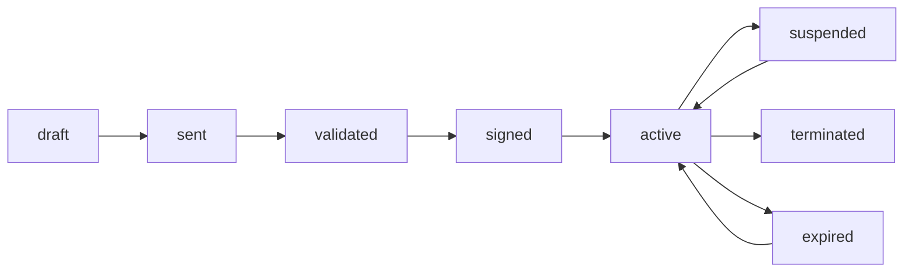

# 🏢 Module Domiciliation d'Entreprise

**Date de création**: 10 décembre 2024  
**Plateforme**: Crésus V2  
**Type**: Module complet (Mobile + Web + Admin)  
**Statut**: ✅ Opérationnel

---

## 📋 Table des matières

1. [Vue d'ensemble](#vue-densemble)
2. [Fonctionnalités](#fonctionnalités)
3. [Architecture](#architecture)
4. [Parcours client](#parcours-client)
5. [Interface administrateur](#interface-administrateur)
6. [Données et types](#données-et-types)
7. [Tarification](#tarification)
8. [Documents requis](#documents-requis)
9. [Flux de paiement](#flux-de-paiement)
10. [États et statuts](#états-et-statuts)

---

## 🎯 Vue d'ensemble

Le module de **Domiciliation d'Entreprise** permet aux entrepreneurs de :
- Obtenir une adresse de siège social professionnelle
- Choisir parmi plusieurs emplacements stratégiques à Dakar
- Bénéficier de services complémentaires (réception courrier, salle de réunion, etc.)
- Signer un contrat de domiciliation en ligne
- Gérer leur domiciliation à distance

### Avantages pour les clients
✅ **Adresse prestigieuse** dans les quartiers d'affaires  
✅ **Flexibilité** : Paiement mensuel, trimestriel ou annuel  
✅ **Services inclus** : Réception courrier, standard téléphonique, etc.  
✅ **Conformité juridique** : Conforme aux exigences du Registre de Commerce  
✅ **100% en ligne** : Contrat et paiement digitalisés

---

## ✨ Fonctionnalités

### 🟢 Côté Client (Mobile & Web)

#### 1. **Consultation des offres**
- Liste des adresses disponibles à Dakar
- Filtrage par zone, prix, services
- Détails complets (services, équipements, disponibilité)
- Photos et localisation

#### 2. **Sélection et configuration**
- Choix de l'adresse de domiciliation
- Sélection de la période (mensuel/trimestriel/annuel)
- Remises automatiques (10% trimestriel, 20% annuel)
- Calcul du prix total avec dépôt de garantie

#### 3. **Upload de documents**
```
Documents requis :
├── Carte d'identité (obligatoire)
├── Statuts de la société (obligatoire)
├── Registre de Commerce (optionnel)
└── NINEA (optionnel)
```

#### 4. **Révision du contrat**
- Visualisation complète du contrat de domiciliation
- Téléchargement PDF
- Ajout de commentaires/questions
- Validation ou rejet avec motif

#### 5. **Paiement**
- Méthodes : Orange Money, Wave, Carte bancaire
- Paiement du loyer + dépôt de garantie
- Confirmation instantanée
- Quittance téléchargeable

#### 6. **Confirmation**
- Récapitulatif de la domiciliation
- Accès au contrat signé
- Téléchargement de la quittance
- Retour au tableau de bord

---

### 🔧 Côté Admin

#### 1. **Tableau de bord**
```
Métriques clés :
├── Contrats actifs
├── Revenus mensuels/annuels
├── Taux d'occupation par adresse
├── Paiements en retard
└── Nouveaux contrats ce mois
```

#### 2. **Gestion des offres**
- Création/modification d'adresses de domiciliation
- Définition des services et tarifs
- Gestion de la disponibilité (quota)
- Publication/suspension d'offres
- Upload de photos

#### 3. **Gestion des contrats**
- Liste de tous les contrats
- Filtrage par statut, date, client
- Validation des documents
- Génération et envoi des contrats
- Suivi des signatures
- Résiliation

#### 4. **Gestion des paiements**
- Émission des factures automatiques
- Suivi des paiements (payé/en retard/partiel)
- Envoi de rappels (email/SMS/WhatsApp)
- Gestion des pénalités de retard
- Historique des transactions

#### 5. **Communications**
- Envoi de notifications aux clients
- Gestion des commentaires sur contrats
- Historique des échanges
- Modèles de messages

#### 6. **Audit et historique**
- Log de toutes les actions
- Traçabilité complète
- Export des données
- Rapports statistiques

---

## 🏗️ Architecture

### Structure des fichiers

```
/components
├── /mobile
│   └── Domiciliation.tsx         # Interface mobile (800+ lignes)
├── /web
│   └── WebDomiciliation.tsx      # Interface web desktop
└── /admin
    └── AdminDomiciliation.tsx    # Dashboard administrateur

/data
└── domiciliationData.ts          # Types, données mock, helpers
```

### Technologies utilisées
- **React** avec TypeScript
- **Motion (Framer Motion)** pour les animations
- **Lucide React** pour les icônes
- **Tailwind CSS** pour le styling
- **Context API** pour le state management

---

## 🚶 Parcours client

### Étape par étape (7 étapes)

#### **Étape 1 : Liste des offres**
```
┌────────────────────────────────────────┐
│  Nos offres de domiciliation          │
├────────────────────────────────────────┤
│                                        │
│  🏢 Plateau Business Center            │
│  📍 Plateau, Dakar                     │
│  50 000 FCFA/mois                      │
│  45/100 places disponibles ✅           │
│                                        │
│  🏢 Almadies Corporate Hub             │
│  📍 Almadies, Dakar                    │
│  75 000 FCFA/mois                      │
│  62/80 places disponibles ✅            │
│                                        │
│  ... autres offres ...                 │
│                                        │
└────────────────────────────────────────┘
```

#### **Étape 2 : Détails de l'offre**
```
┌────────────────────────────────────────┐
│  🏢 Plateau Business Center            │
│  Avenue Léopold Sédar Senghor          │
├────────────────────────────────────────┤
│  Services inclus :                     │
│  ✓ Réception du courrier               │
│  ✓ Scan et envoi email                 │
│  ✓ Salle de réunion 2h/mois            │
│  ✓ Standard téléphonique               │
│                                        │
│  Équipements :                         │
│  🏷️ Quartier d'affaires                │
│  🏷️ Parking disponible                 │
│  🏷️ Sécurité 24/7                      │
│  🏷️ Wifi gratuit                       │
│                                        │
│  Capacité : 50 courriers/mois          │
│  Disponibilité : 45 places             │
│                                        │
│  [Continuer]                           │
└────────────────────────────────────────┘
```

#### **Étape 3 : Choix de la période**
```
┌────────────────────────────────────────┐
│  Choisissez votre période              │
├────────────────────────────────────────┤
│                                        │
│  ⭕ Mensuel                             │
│     50 000 FCFA                        │
│     Paiement mensuel                   │
│                                        │
│  ⭕ Trimestriel  [-10%]                 │
│     135 000 FCFA                       │
│     Paiement tous les 3 mois           │
│                                        │
│  ⭕ Annuel  [-20%]                      │
│     480 000 FCFA                       │
│     Paiement annuel                    │
│                                        │
│  ℹ️ Dépôt de garantie :                │
│     50 000 FCFA sera requis            │
│                                        │
└────────────────────────────────────────┘
```

#### **Étape 4 : Upload documents**
```
┌────────────────────────────────────────┐
│  Pièces justificatives                 │
├────────────────────────────────────────┤
│                                        │
│  🪪 Carte d'identité                   │
│  ✅ Téléversé                           │
│                                        │
│  📄 Statuts de la société              │
│  ✅ Téléversé                           │
│                                        │
│  📋 Registre de Commerce [Optionnel]   │
│  ⏳ En attente          [📤 Upload]    │
│                                        │
│  [Continuer]                           │
└────────────────────────────────────────┘
```

#### **Étape 5 : Révision du contrat**
```
┌────────────────────────────────────────┐
│  📄 Contrat de domiciliation           │
│  Contrat V1.0                          │
│  Généré le 10/12/2024                  │
├────────────────────────────────────────┤
│                                        │
│  Ce contrat établit les conditions     │
│  de domiciliation pour Plateau         │
│  Business Center.                      │
│                                        │
│  • Période: Mensuel                    │
│  • Montant: 50 000 FCFA                │
│  • Services: [liste...]                │
│                                        │
│  [👁️ Voir]  [⬇️ Télécharger]           │
│                                        │
│  Commentaires (optionnel):             │
│  [________________________]            │
│                                        │
│  [❌ Rejeter]  [✅ Valider]            │
└────────────────────────────────────────┘
```

#### **Étape 6 : Paiement**
```
┌────────────────────────────────────────┐
│  💳 Paiement                           │
├─────────────────────────────────��──────┤
│  Période :          Mensuel            │
│  Montant :          50 000 FCFA        │
│  Dépôt :            50 000 FCFA        │
│  ───────────────────────────────       │
│  Total à payer :    100 000 FCFA       │
│                                        │
│  Méthode de paiement :                 │
│                                        │
│  📱 Orange Money              ›        │
│  💳 Wave                      ›        │
│  💳 Carte bancaire            ›        │
│                                        │
│  [Confirmer le paiement]               │
└────────────────────────────────────────┘
```

#### **Étape 7 : Confirmation**
```
┌────────────────────────────────────────┐
│           ✅                           │
│                                        │
│  Domiciliation confirmée !             │
│                                        │
│  Votre contrat est actif et vous       │
│  recevrez tous les détails par email   │
│                                        │
│  Adresse :    Plateau Business Center  │
│  Période :    Mensuel                  │
│  Montant :    50 000 FCFA              │
│                                        │
│  [Retour au tableau de bord]           │
│                                        │
│  [📄 Contrat]  [🧾 Quittance]          │
└────────────────────────────────────────┘
```

---

## 🔑 Données et types

### **DomiciliationOffer**
```typescript
interface DomiciliationOffer {
  id: string;
  name: string;                    // "Plateau Business Center"
  address: string;                 // "Avenue Léopold Sédar Senghor"
  zone: string;                    // "Plateau"
  city: string;                    // "Dakar"
  postalCode: string;              // "BP 1234"
  description: string;
  services: string[];              // ["Réception courrier", "Scan email", ...]
  receptionCapacity: number;       // 50 courriers/mois
  prices: {
    monthly: number;               // 50000
    quarterly: number;             // 135000 (10% discount)
    yearly: number;                // 480000 (20% discount)
  };
  deposit?: number;                // 50000 FCFA
  quota: number;                   // 100 (capacité totale)
  available: number;               // 45 (places disponibles)
  status: 'draft' | 'published' | 'suspended';
  features: string[];              // ["Parking", "Wifi", ...]
  images?: string[];
}
```

### **DomiciliationContract**
```typescript
interface DomiciliationContract {
  id: string;
  offerId: string;
  userId: string;
  companyId?: string;
  status: ContractStatus;          // voir ci-dessous
  period: 'monthly' | 'quarterly' | 'yearly';
  startDate: string;
  endDate: string;
  monthlyAmount: number;
  totalAmount: number;
  deposit?: number;
  autoRenewal: boolean;
  renewalNotice: number;           // jours (ex: 30)
  contractUrl?: string;
  version: number;
  signedAt?: string;
  signedBy?: string[];
  comments: ContractComment[];
  documents: ContractDocument[];
  createdAt: string;
  updatedAt: string;
}
```

### **DomiciliationPayment**
```typescript
interface DomiciliationPayment {
  id: string;
  contractId: string;
  userId: string;
  type: 'deposit' | 'rent' | 'penalty';
  amount: number;
  dueDate: string;
  paidDate?: string;
  status: PaymentStatus;           // voir ci-dessous
  method?: 'orange_money' | 'wave' | 'card';
  transactionId?: string;
  receiptUrl?: string;
  reminders: PaymentReminder[];
}
```

---

## 💰 Tarification

### Offres disponibles

| Adresse | Zone | Prix/mois | Prix/trim | Prix/an | Dépôt |
|---------|------|-----------|-----------|---------|-------|
| **Plateau Business Center** | Plateau | 50 000 | 135 000 | 480 000 | 50 000 |
| **Almadies Corporate Hub** | Almadies | 75 000 | 202 500 | 720 000 | 75 000 |
| **Mermoz Tech Park** | Mermoz | 60 000 | 162 000 | 576 000 | 60 000 |
| **Point E Business Center** | Point E | 35 000 | 94 500 | 336 000 | - |

### Remises automatiques
- **Trimestriel** : -10% sur le total
- **Annuel** : -20% sur le total

### Calcul du prix

```typescript
const calculatePeriodPrice = (monthlyPrice: number, period: PeriodType): number => {
  switch (period) {
    case 'monthly':
      return monthlyPrice;
    case 'quarterly':
      return monthlyPrice * 3 * 0.9;  // 10% discount
    case 'yearly':
      return monthlyPrice * 12 * 0.8; // 20% discount
  }
};
```

### Exemple de calcul
```
Adresse : Plateau Business Center (50 000 FCFA/mois)
Période : Annuel

Prix sans remise : 50 000 × 12 = 600 000 FCFA
Remise annuelle (-20%) : -120 000 FCFA
Prix avec remise : 480 000 FCFA
Dépôt de garantie : 50 000 FCFA

TOTAL À PAYER : 530 000 FCFA
```

---

## 📄 Documents requis

### Par type de société

#### **SARL / SASU / SUARL**
```
✅ Obligatoires :
├── Carte d'identité du gérant
└── Statuts de la société

📋 Optionnels :
├── Registre de Commerce
└── NINEA
```

#### **SA**
```
✅ Obligatoires :
├── Carte d'identité du DG
└── Statuts de la société

📋 Optionnels :
├── Registre de Commerce
└── NINEA
```

#### **SAS**
```
✅ Obligatoires :
├── Carte d'identité du président
└── Statuts de la société

📋 Optionnels :
└── Registre de Commerce
```

### Validation des documents

L'admin doit valider chaque document :
- ✅ **Validé** : Document conforme
- ❌ **Rejeté** : Document à refaire (avec motif)
- ⏳ **En attente** : Pas encore vérifié

---

## 💳 Flux de paiement

### 1. Émission de facture (Admin)
```
Admin → Génère facture automatique
      → Envoi email + notification
      → État : "issued"
```

### 2. Paiement (Client)
```
Client → Choisit méthode (Orange Money/Wave/Carte)
       → Effectue paiement
       → Reçoit quittance
       → État : "paid"
```

### 3. Suivi (Admin)
```
Admin → Voit paiements en attente
      → Envoie rappels si retard
      → Applique pénalités si besoin
```

### Pénalités de retard
- **Taux** : 2% par mois de retard
- **Indemnité forfaitaire** : 25 000 FCFA pour frais de recouvrement

---

## 📊 États et statuts

### **ContractStatus**

| Statut | Description | Couleur | Action possible |
|--------|-------------|---------|-----------------|
| `draft` | Brouillon | Gris | Modifier, Supprimer |
| `sent` | Envoyé au client | Bleu | Relancer, Annuler |
| `validated` | Validé par le client | Violet | Faire signer |
| `signed` | Signé | Indigo | Activer |
| `active` | Actif | Vert | Suspendre, Résilier |
| `suspended` | Suspendu | Orange | Réactiver, Résilier |
| `terminated` | Résilié | Rouge | Archiver |
| `expired` | Expiré | Gris | Renouveler |

### **PaymentStatus**

| Statut | Description | Couleur | Action possible |
|--------|-------------|---------|-----------------|
| `to_issue` | À émettre | Gris | Émettre facture |
| `issued` | Émise | Bleu | Envoyer rappel |
| `paid` | Payée | Vert | Voir quittance |
| `late` | En retard | Rouge | Relancer, Pénalités |
| `partial` | Partielle | Orange | Réclamer solde |
| `cancelled` | Annulée | Gris | - |

### Machine à états du contrat



---

## 🎨 Design et UX

### Palette de couleurs Crésus

```css
--primary-dark:   #1A2753  /* Bleu nuit */
--primary-gold:   #D6A93A  /* Or impérial */
--primary-blue:   #273A7A  /* Bleu acier */
--white:          #FFFFFF  /* Blanc */
--background:     #F5F6FA  /* Gris perle */
```

### Animations (Motion)

```typescript
// Entrée de page
initial={{ opacity: 0, y: 20 }}
animate={{ opacity: 1, y: 0 }}
exit={{ opacity: 0, y: -20 }}

// Bouton pressé
whileTap={{ scale: 0.98 }}

// Barre de progression
initial={{ scale: 0 }}
animate={{ scale: 1 }}
transition={{ delay: index * 0.1 }}
```

### Responsive

- **Mobile** : Design mobile-first avec gestures
- **Web** : Layout 2-colonnes avec sidebar
- **Admin** : Dashboard multi-panels

---

## 🧪 Tests recommandés

### Test 1 : Parcours complet client
```
✓ Sélectionner une offre
✓ Choisir la période annuelle (remise 20%)
✓ Uploader tous les documents
✓ Valider le contrat
✓ Effectuer le paiement
✓ Voir la confirmation
```

### Test 2 : Rejet de contrat
```
✓ Arriver à l'étape "contract-review"
✓ Cliquer sur "Rejeter"
✓ Sélectionner un motif
✓ Ajouter un commentaire
✓ Confirmer le rejet
✓ Vérifier retour à "offers"
```

### Test 3 : Disponibilité
```
✓ Vérifier que seules les offres "published" s'affichent
✓ Vérifier l'affichage du nombre de places disponibles
✓ Vérifier qu'on ne peut pas sélectionner si 0 place disponible
```

### Test 4 : Admin - Gestion contrat
```
✓ Voir liste des contrats
✓ Filtrer par statut
✓ Valider des documents
✓ Générer et envoyer un contrat
✓ Voir historique des actions
```

---

## 📱 Captures d'écran (Mobile)

### Vue liste des offres
- Cards avec gradient
- Icônes Building2
- Prix en or (#D6A93A)
- Badge "Disponible" vert

### Vue détails offre
- Header avec icône
- Liste des services (checkmarks)
- Tags pour équipements
- Capacité et disponibilité

### Vue contrat
- Aperçu du PDF
- Boutons "Voir" et "Télécharger"
- Zone de commentaires
- Actions "Valider" / "Rejeter"

---

## 🚀 Améliorations futures

### Version 2.0
- [ ] Intégration Google Maps pour localisation
- [ ] Upload de photos des locaux
- [ ] Visite virtuelle 360°
- [ ] Système de notation/avis clients
- [ ] Comparateur d'offres
- [ ] Notification push pour courrier reçu
- [ ] Chatbot pour questions fréquentes
- [ ] Export iCal pour échéances
- [ ] Programme de parrainage
- [ ] Application de gestion courrier (scan dans l'app)

### Backend à implémenter
- [ ] API REST pour CRUD offres
- [ ] API génération PDF contrat
- [ ] API signature électronique
- [ ] Webhook paiements (Orange Money/Wave)
- [ ] Cron job rappels de paiement
- [ ] Service envoi courrier (email/SMS)
- [ ] Dashboard analytics Metabase
- [ ] Intégration comptabilité (Sage/Odoo)
- [ ] Export données RGPD

---

## 📚 Documentation technique

### Helpers disponibles

```typescript
// Calcul du prix selon période
calculatePeriodPrice(monthlyPrice: number, period: PeriodType): number

// Label de période
getPeriodLabel(period: PeriodType): string  // "Mensuel", "Trimestriel", "Annuel"

// Durée en mois
getPeriodDuration(period: PeriodType): number  // 1, 3, 12

// Label de statut
getContractStatusLabel(status: ContractStatus): string
getPaymentStatusLabel(status: PaymentStatus): string

// Couleur de statut
getContractStatusColor(status: ContractStatus): string
getPaymentStatusColor(status: PaymentStatus): string
```

### Formatage prix

```typescript
const formatPrice = (price: number) => {
  return new Intl.NumberFormat('fr-FR', {
    style: 'currency',
    currency: 'XOF',
    minimumFractionDigits: 0
  }).format(price);
};

// Exemple : formatPrice(50000) → "50 000 FCFA"
```

---

## 🔗 Liens avec autres modules

### Module Création d'entreprise
- Utilise l'adresse de domiciliation pour le siège social
- Peut proposer domiciliation pendant la création
- Partage les documents (statuts)

### Module Signature électronique
- Signature du contrat de domiciliation
- Stockage du contrat signé
- Certificat de signature

### Module Branding
- Peut utiliser l'adresse sur cartes de visite
- Création de tampons avec adresse
- Design d'en-tête courrier

---

## ✅ Checklist de déploiement

### Avant la mise en production

- [ ] Vérifier que toutes les offres ont des prix cohérents
- [ ] Tester le parcours complet sur mobile
- [ ] Tester le parcours complet sur web
- [ ] Vérifier la génération du contrat PDF
- [ ] Tester l'intégration paiement
- [ ] Configurer les emails transactionnels
- [ ] Préparer la documentation client
- [ ] Former l'équipe admin
- [ ] Définir les SLA (délais de réponse)
- [ ] Mettre en place monitoring

### Configuration requise

```env
# Variables d'environnement
SUPABASE_URL=https://your-project.supabase.co
SUPABASE_ANON_KEY=your-anon-key
ORANGE_MONEY_API_KEY=your-api-key
WAVE_API_KEY=your-api-key
STRIPE_PUBLIC_KEY=pk_live_xxx
EMAIL_SERVICE_API_KEY=your-api-key
SMS_SERVICE_API_KEY=your-api-key
```

---

## 📞 Support

### Pour les développeurs
- **Fichiers** : `/components/{mobile,web,admin}/Domiciliation.tsx`
- **Data** : `/data/domiciliationData.ts`
- **Types** : Tous définis dans `domiciliationData.ts`

### Pour les admins
- **Accès** : Dashboard Admin → Domiciliation
- **Documentation** : [À créer] Guide administrateur
- **Support** : support@cresus.sn

---

**Version** : 1.0.0  
**Dernière mise à jour** : 10 décembre 2024  
**Auteur** : Équipe Crésus V2  
**Licence** : Propriétaire
